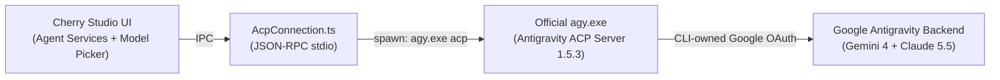

# Cherry Studio Fork: Official Google Antigravity ACP Integration Spec

## 1. Goal & Scope

Fork `CherryHQ/cherry-studio` to `Andy-Lin55/cherry-studio` based on upstream PR [#21221](https://github.com/CherryHQ/cherry-studio/pull/21221) (`kangfenmao/multica-local-agents`), patch the `antigravity-acp` preset so it natively discovers, installs, and launches the public cross-platform Antigravity CLI (`agy acp`, including Windows `agy.exe`), back up the existing Cherry Studio database, and build a runnable Windows x64 application wired to the user's existing data directory.

> [!IMPORTANT]
> **Compliance Boundary:** All communication with Google Antigravity uses the official `agy` binary's Agent Client Protocol (`agy acp` over JSON-RPC `stdio`) and ACP's built-in `oauth-personal` ("Log in with Google") flow. Cherry Studio never reads, copies, or proxies `~/.gemini/antigravity-cli/antigravity-oauth-token`.

---

## 2. Verified Model Entitlements Over `agy`

Querying the installed [agy.exe](file:///D:/BaiduNetdiskDownload/cherryStudio/Toolchain/mise/installs/aqua-google-antigravity-antigravity-cli/1.5.1/agy.exe) (`v1.5.1` / ACP server `v1.5.3`) confirms that `antigravity-acp` exposes **both Gemini and Claude models** inside Cherry Studio's Agent Services conversations:

| Family | Model IDs Exposed by `agy` | Display Names |
|---|---|---|
| **Claude Opus 5.5** | `claude-opus-5-5-low`, `claude-opus-5-5-medium`, `claude-opus-5-5-high` | Claude Opus 5.5 (Low / Medium / High) |
| **Claude Sonnet 5.5** | `claude-sonnet-5-5-low`, `claude-sonnet-5-5-medium`, `claude-sonnet-5-5-high` | Claude Sonnet 5.5 (Low / Medium / High) |
| **Gemini 4 Argon** | `gemini-4-argon-low`, `gemini-4-argon-medium`, `gemini-4-argon-high` | Gemini 4 Argon (Low / Medium / High) |
| **Gemini 3.8 Flash** | `gemini-3.8-flash-low`, `gemini-3.8-flash-medium`, `gemini-3.8-flash-high` | Gemini 3.8 Flash (Low / Medium / High) |
| **GPT-OSS** | `gpt-oss-120b-medium` | GPT-OSS 120B (Medium) |

> [!NOTE]
> **Where these models appear:** ACP models are available inside Cherry Studio's **Agent Services / Agent Sessions** (full multi-turn chat, file/terminal tools, MCP servers, skills, and model switching via `AcpConnection.ts`). They are not exposed as a raw `/v1/chat/completions` HTTP endpoint for non-agent features like translation or embeddings.

---

## 3. Architecture & File-Level Design

### 3.1 Repository & Branch Structure
- **Upstream Source:** `CherryHQ/cherry-studio`, branch `kangfenmao/multica-local-agents` (PR #21221).
- **User Fork:** `https://github.com/Andy-Lin55/cherry-studio.git`, feature branch `feat/antigravity-acp-windows`.
- **Local Source Directory:** `D:\BaiduNetdiskDownload\cherryStudio\cherry-studio-src` (isolated inside a dedicated subdirectory so source/build files never collide with Cherry Studio's live `Data/`, `Cache/`, and `Toolchain/` folders).
- **Committed Spec Location in Repo:** `docs/superpowers/specs/2026-11-07-antigravity-acp-windows-design.md`.

### 3.2 Component Changes

1. **Preset Definition (`src/shared/ai/localAgent.ts`)**
   - Change `antigravity-acp` primary binary from `agy_acp_server.par` to `agy` with `args: ['acp']`:
     - `id: 'antigravity-acp'`
     - `name: 'Google Antigravity'`
     - `protocol: 'acp'`
     - `executable: 'agy'`
     - `aliases: ['agy_acp_server.par', 'agy_acp_server']`
     - `args: ['acp']`
     - `terminalExecutable: 'agy'`
     - `terminalArgs: []`
     - `loginArgs: ['acp', '--login']`
     - `helpUrl: 'https://antigravity.google/docs/ide/extensions'`

2. **Launch Argument Resolution (`src/main/ai/runtime/localAgent/launch.ts`)**
   - In `resolveLocalAgentLaunch`, when `config.args` is empty and `preset?.id === 'antigravity-acp'`, inspect `path.basename(executable).toLowerCase()`:
     - If the resolved executable starts with `agy_acp_server` (legacy standalone binary), pass `process.platform === 'linux' ? ['--uid='] : []`.
     - Otherwise (`agy` / `agy.exe` / `agy.cmd`), pass `preset.args` (`['acp']`).
   - This preserves backward compatibility with legacy Linux `.par` installs while making Windows/macOS/Linux `agy` CLI installs work out of the box.

3. **Installer Recipe Lookup (`src/main/ai/runtime/localAgent/installRecipe.ts`)**
   - Include `'antigravity-acp'` alongside `['kimi', 'hermes', 'deepseek-harness', 'openclaw']` in `resolveInstallRecipe` so `CODE_CLI_TOOL_PRESETS.find((entry) => entry.executable === 'agy')` resolves to `resolveCliInstallRecipe` (`https://antigravity.google/cli/install.ps1` on `win32`, `https://antigravity.google/cli/install.sh` on `darwin`/`linux`).

4. **Unit Tests**
   - `src/main/ai/runtime/localAgent/__tests__/launch.test.ts`:
     - Verify `antigravity-acp` launches `agy` with `['acp']` across platforms when `agy` is installed.
     - Verify `antigravity-acp` falls back to `agy_acp_server.par` (with `['--uid=']` on Linux and `[]` elsewhere) when only the legacy binary is present.
     - Verify `detectLocalAgents()` populates both `path` and `terminalPath` when `agy` is installed via `mise` or `system`.
   - `src/main/ai/runtime/localAgent/__tests__/installRecipe.test.ts`:
     - Verify `resolveInstallRecipe('antigravity-acp', undefined, 'win32')` and `'darwin'` return the official PowerShell/bash install scripts.

---

## 4. Data Safety, Build & Verification Pipeline

1. **Database Backup (Pre-Launch Gate):**
   - Check if `Cherry Studio.exe` is running before switching builds; copy `Data\cherrystudio.sqlite`, `Data\cherrystudio.sqlite-wal`, and `Data\cherrystudio.sqlite-shm` to `D:\BaiduNetdiskDownload\cherryStudio\Data\backups\pre-acp-20261107\`.
2. **Build Environment via `mise`:**
   - Use `C:\Users\andyl\.cherrystudio\bin\mise.exe` to provision `node@24` and `pnpm@12.6.0` scoped to `cherry-studio-src` (leaving system Node `v22.15.0` untouched).
3. **Automated Verification:**
   - Run targeted Vitest suites (`launch.test.ts`, `installRecipe.test.ts`) and `pnpm typecheck:node` / `pnpm typecheck:web`.
4. **Windows Packaging & User-Data Wiring:**
   - Build unpacked Windows x64 app (`electron-builder --win --x64 --dir`) under `cherry-studio-src\dist\win-unpacked\Cherry Studio.exe`.
   - Register the new `Cherry Studio.exe` path in `C:\Users\andyl\.cherrystudio\config\config.json` and `C:\Users\andyl\.cherrystudio\boot-config.json` mapped to `D:\BaiduNetdiskDownload\cherryStudio` (preserving the existing `D:\Cherry Studio\Cherry Studio.exe` entry alongside it).
   - Push `feat/antigravity-acp-windows` to `Andy-Lin55/cherry-studio`.
5. **Post-Build Smoke Check:**
   - Launch the built app (or verify ACP startup) so you can sign in once via **Agent Services → Google Antigravity → Sign in with Google** and select Gemini 4 / Claude 5.5 models directly in chat.
